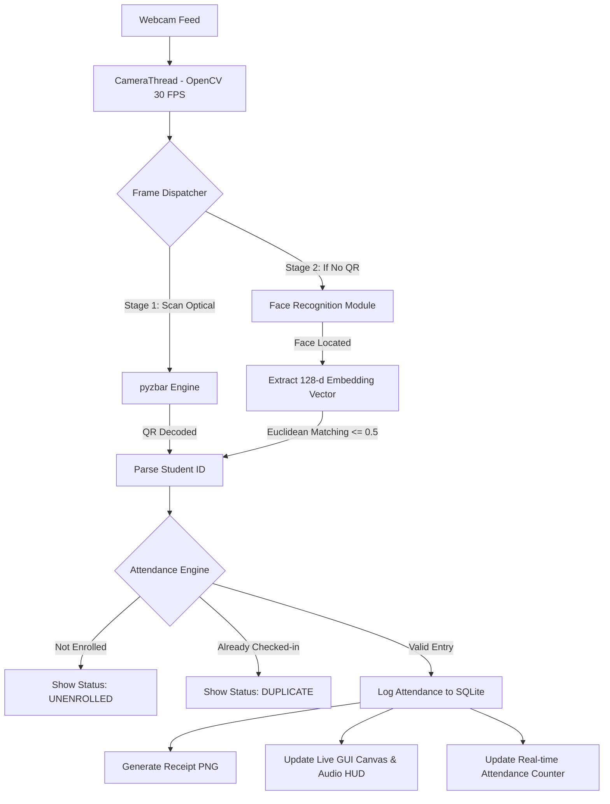

<div align="center">

# ⚡ ATTEND-X
### **Next-Gen Campus Attendance Terminal**
*One Camera. Zero Queues. Dual-Mode Biometric & Optical Check-In.*

[](https://www.python.org/)
[](https://opencv.org/)
[](https://docs.python.org/3/library/tkinter.html)
[-003B57?style=for-the-badge&logo=sqlite&logoColor=white)](https://sqlite.org/)
[](https://github.com/ageitgey/face_recognition)
[](https://github.com/NaturalHistoryMuseum/pyzbar)
[](#license)

<br/>

```
  █████╗ ████████╗████████╗███████╗███╗   ██╗██████╗     ██╗  ██╗
 ██╔══██╗╚══██╔══╝╚══██╔══╝██╔════╝████╗  ██║██╔══██╗    ╚██╗██╔╝
 ███████║   ██║      ██║   █████╗  ██╔██╗ ██║██║  ██║     ╚███╔╝ 
 ██╔══██║   ██║      ██║   ██╔══╝  ██║╚██╗██║██║  ██║     ██╔██╗ 
 ██║  ██║   ██║      ██║   ███████╗██║ ╚████║██████╔╝    ██╔╝ ██╗
 ╚═╝  ╚═╝   ╚═╝      ╚═╝   ╚══════╝╚═╝  ╚═══╝╚═════╝     ╚═╝  ╚═╝
```

> **ATTEND-X** replaces slow, paper-based roll calls and proxy attendance with a unified, high-speed campus terminal.  
> Using **OpenCV multi-threading**, **dlib biometric landmark embeddings**, and **optical QR decoding**, students attend classes in **< 1 second** — simply by looking at the camera or presenting their student ID card.

---

</div>

## 📌 At A Glance

| Metric / Capability | Specification |
|---|---|
| **Recognition Speed** | `< 0.8s` (Sub-second dual-mode detection) |
| **Detection Methods** | **Facial Biometrics** (128-d Euclidean) + **Optical QR/Barcode** (`pyzbar`) |
| **Concurrency Engine** | Multi-threaded background capture (`CameraThread`) decoupled from UI |
| **Camera FPS** | 30 FPS steady non-blocking Tkinter video feed |
| **Anti-Proxy Protection** | One check-in per session with active class & enrollment verification |
| **Digital Verification** | Auto-generates high-resolution verification receipt image (`AX-YYMMDD-HHMMSS`) |
| **Reporting** | Subject-wise analytics with instant CSV export for College ERP |
| **Deployment** | 100% offline, privacy-first, zero cloud latency, local SQLite WAL engine |

---

## 🖥️ Live Terminal HUD Demo

```text
 ┌────────────────────────────────────────────────────────────────────────┐
 │  ATTEND-X : CAMPUS ATTENDANCE TERMINAL                     [ 09:14:02 ] │
 │  ACTIVE CLASS: CS-501 (Data Structures) | PROF. S. SHARMA  [ ● RUNNING] │
 ├────────────────────────────────────────┬───────────────────────────────┤
 │                                        │  STUDENT VERIFICATION HUD    │
 │       ┌────────────────────────┐       │  Name:     Rahul Patel        │
 │       │     [ LIVE 30 FPS ]    │       │  Roll No:  23CS014            │
 │       │                        │       │  Branch:   CSE (Sem 5)        │
 │       │    ● FACE DETECTED     │       │  Method:   BIOMETRIC_FACE     │
 │       │   [0.42 MATCH SCORE]   │       │  Status:   ✓ PRESENT          │
 │       └────────────────────────┘       │  Receipt:  AX-261013-091402   │
 │                                        ├───────────────────────────────┤
 │    LOOK AT CAMERA OR SCAN ID CARD      │  SESSION ATTENDANCE TIMELINE  │
 │          [ 42 / 60 PRESENT ]           │  09:13:58  Jay S.    ID CARD  │
 │     [=====================>    ] 70%   │  09:14:02  Rahul P.  FACE     │
 └────────────────────────────────────────┴───────────────────────────────┘
```

---

## 🚀 Key Features

### 👁️ Dual-Mode Biometric & Optical Recognition
* **Zero Mode Switching:** No buttons to press. The unified vision pipeline automatically identifies whether a face is in frame or a student is holding up an ID card QR code.
* **128-Dimensional Facial Vectors:** Extracts biometric landmark embeddings using deep neural networks to match faces across varied lighting and angles.
* **High-Speed QR Engine:** Preprocesses camera frames with adaptive thresholding and contrast normalization to scan ID cards instantly.

### 🛡️ Active Class Sessions & Anti-Proxy Engine
* **Subject Context:** Attendance is tied to scheduled course sessions (e.g., *CS-501, Operating Systems*).
* **Strict Enrollment Verification:** Students not enrolled in the active subject are rejected (`UNENROLLED`).
* **Anti-Duplicate Lock:** Students cannot be scanned twice within the same class session (`DUPLICATE REJECTED`).

### 🪪 Automated ID Card & Digital Receipt Synthesis
* **Printable ID Card Generator:** Built-in Pillow rendering engine that generates customized, campus-branded ID card PNGs with embedded QR codes and student portraits.
* **Digital Attendance Receipts:** Instant high-resolution cryptographic verification token (`AX-YYMMDD-HHMMSS.png`) generated for students as proof of attendance.

### 📊 Real-Time Analytics & CSV Reports
* **Subject-Wise Breakdown:** Filter attendance records by subject code, date range, branch, or semester.
* **ERP-Ready Export:** Generates clean CSV spreadsheets with attendance percentage calculations for university management systems.

### 🎮 Standalone Demo Simulation Mode
* Built-in simulation tool allowing faculty or viva examiners to test facial and barcode recognition without needing an external webcam.

---

## 🔄 System Architecture & Data Flow



---

## 🛠️ Technology Stack

| Layer | Technologies Used | Description |
|---|---|---|
| **Core Language** |  **Python 3.10+** | Modern typed Python with dataclasses & logging |
| **Computer Vision** |  **OpenCV (`cv2`)** | Video capture, frame preprocessing & bounding-box tracking |
| **Biometrics** |  **`face_recognition`** | HOG/CNN face detection & 128-d embedding extraction |
| **Optical Scanner** |  **`pyzbar`** | C-based optical barcode & QR code decoding |
| **User Interface** |  **Tkinter / ttk** | Responsive dark-mode terminal UI with custom HUD |
| **Concurrency** |  **Python `threading`** | Decoupled background capture to prevent UI lag |
| **Image Synthesis** |  **Pillow & `qrcode`** | ID card and digital receipt layout generation |
| **Database** |  **SQLite3** | Relational storage with WAL mode & atomic transactions |
| **Data Analytics** |  **Pandas** | Tabular data analysis and CSV report exports |

---

## 📂 Project Structure

```
ATTEND-X/
├── main.py                     # Application entry point & bootstrapping
├── gui.py                      # Full Tkinter dark terminal UI & HUD (2,600+ LOC)
├── camera.py                   # Multi-threaded OpenCV video capture pipeline
├── database.py                 # SQLite relational schema, queries & WAL mode
├── attendance.py               # Attendance validation, duplicate checks & session rules
├── face_recognition_module.py  # Biometric facial landmark & vector matching
├── barcode_scanner.py          # PyZbar optical decoding & contrast filter engine
├── id_card.py                  # Automated printable student ID card generator
├── receipt.py                  # Digital attendance verification receipt synthesis
├── subjects.py                 # Academic courses & class session management
├── students.py                 # Student catalog & photo mapping
├── reports.py                  # Subject attendance analytics & CSV export
│
├── test_face_validation.py     # Face tolerance & accuracy test suite
├── test_subject_system.py      # Session & enrollment unit tests
├── test_id_card_fix.py         # ID card layout & DPI rendering tests
├── verify_id_scanner_fix.py    # Scanner hardware verification test harness
│
├── data/                       # Local SQLite database (attendx.db)
├── faces/                      # Student face biometric registration photos
├── generated_cards/            # Generated student ID card PNGs
├── exports/                    # Exported attendance CSV spreadsheets
│   └── receipts/               # Generated digital verification receipts
│
├── requirements.txt            # Project dependencies
└── README.md                   # Technical documentation
```

## ⚡ Quick Installation & Setup

### 1. Clone the Repository
```bash
git clone https://github.com/MJ-Meet/ATTEND-X.git
cd ATTEND-X
```

### 2. Set Up Virtual Environment
```bash
# Windows
python -m venv venv
venv\Scripts\activate
```

### 3. Install Core Dependencies
```bash
pip install opencv-python Pillow "qrcode[pil]" pandas pyzbar
```

### 4. Install Biometric Face Recognition *(Optional but Recommended)*
To install `face_recognition` on Windows without needing Visual Studio C++ compilers:
```bash
pip install dlib-bin
pip install face_recognition_models "setuptools<72"
pip install face_recognition --no-deps
```

> **Note:** ATTEND-X features graceful degradation. If `face_recognition` is not installed, the terminal runs seamlessly using **ID Card QR scanning**.

### 5. Launch the Application
```bash
python main.py
```

---

## 🎯 Quick Start Guide

1. **Launch Terminal:** Run `python main.py`. The database initializes automatically.
2. **Load Sample Data:** Click **STUDENTS** → **LOAD DEMO DATA** to populate sample students.
3. **Generate ID Card:** Go to **STUDENTS** → select a student → **GENERATE ID CARD** to create a printable card with an embedded QR code.
4. **Register Faces:** Go to **STUDENTS** → select student → **CAPTURE FACE** to train biometric embeddings.
5. **Start Class Session:** Go to **TERMINAL** → pick your subject → Click **[ START SESSION ]**.
6. **Mark Attendance:** Hold an ID card to the webcam or look directly at the lens.
7. **End & Export:** Click **[ ⏹ END SESSION ]** to view the session summary, then export reports under **REPORTS** → **EXPORT CSV**.

---

## 🔒 Privacy & Local-First Philosophy

* 🛡️ **Zero Cloud Transmission:** Biometric embeddings and student data never leave the local machine.
* 💾 **No Video Recording:** Video frames are processed in-memory and discarded immediately; no surveillance video is saved.
* 🔐 **Isolated Embeddings:** Facial data is stored as 128-dimensional floating point vectors inside local SQLite storage.

---

## 📄 License

Developed for academic engineering purposes under the **MIT License**.

---

<div align="center">
  <b>Built with ❤️ by the ATTEND-X Team</b><br/>
  <i>Python · OpenCV · Tkinter · SQLite · face_recognition · pyzbar · Pillow</i>
</div>
